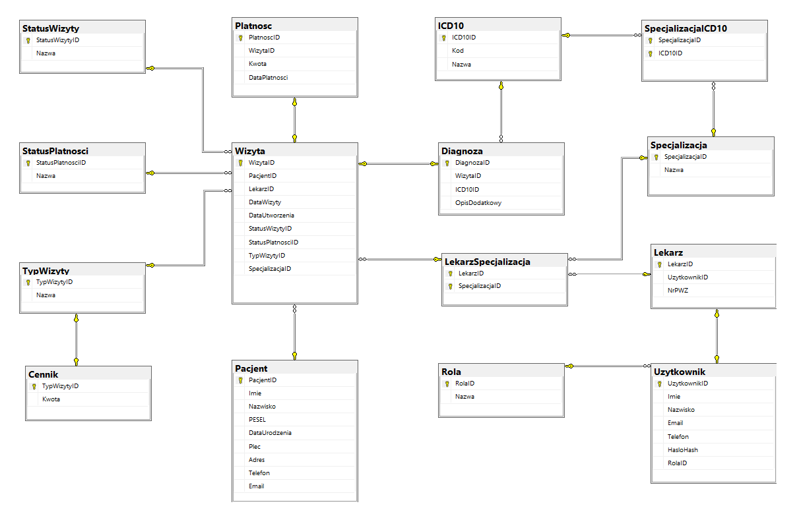

# Baza danych poradni medycznej

## Struktura bazy danych

Relacyjna baza danych `PoradniaDB` obejmuje obsługę pacjentów, lekarzy, specjalizacji, wizyt, diagnoz ICD-10 oraz płatności.

Zaimplementowano klucze główne i obce, ograniczenia integralności, indeksy, widoki, procedury składowane, funkcje i triggery.

### Diagram ERD

## Zawartość katalogu

| Plik | Zawartość |
|---|---|
| `01_struktura_bazy.sql` | Definicje tabel, relacji, ograniczeń i indeksów |
| `02_widoki.sql` | Widoki kontrolne i analityczne, w tym `vw_FactWizyty` |
| `03_procedury_triggery_funkcje.sql` | Procedury operacyjne, funkcje i triggery |
| `04_dane_testowe.sql` | Syntetyczne dane testowe |
| `05_zapytania_analityczne.sql` | Zapytania analityczne i kontrola spójności danych |

## Uruchomienie

W Microsoft SQL Server Management Studio należy wykonać skrypty na odpowiedniej instancji SQL Server w następującej kolejności:

1. `01_struktura_bazy.sql` – utworzenie bazy danych `PoradniaDB` i jej struktury.
2. `02_widoki.sql` – utworzenie widoków.
3. `03_procedury_triggery_funkcje.sql` – utworzenie procedur, funkcji i triggerów.
4. `04_dane_testowe.sql` – wprowadzenie danych testowych.

Skrypt `05_zapytania_analityczne.sql` służy do dodatkowej analizy i weryfikacji danych.

Skrypty przeznaczone są do inicjalizacji projektu w pustej bazie. Ponowne uruchomienie ich na już wypełnionej bazie może powodować konflikty istniejących obiektów lub danych.

## Wybrane rozwiązania

- Relacja lekarzy i specjalizacji z kontrolą poprawności przypisania specjalizacji do wizyty.
- Walidacja terminów i danych podczas rejestracji wizyt.
- Kontrola zgodności diagnoz ICD-10 ze specjalizacjami.
- Rozdzielenie dat wykonania świadczeń i dat płatności.
- Widoki wykrywające wybrane niespójności danych.
- Widok `vw_FactWizyty` przygotowujący dane do systemu raportowania.
